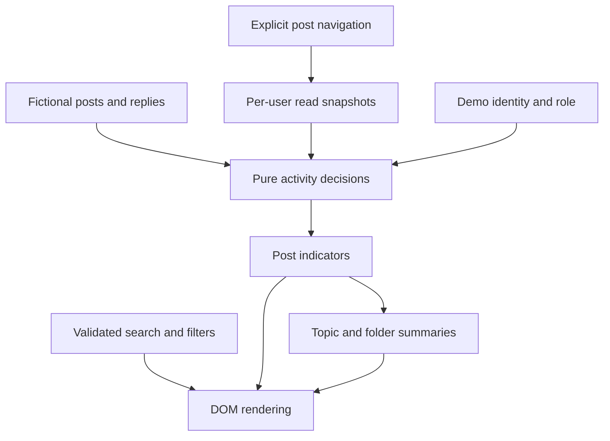

# Architecture and activity state

## Activity boundary

`isUnread` considers post creation and replies by people other than the viewer after the last read snapshot. It evaluates all unseen activity, so a newer own reply cannot conceal an earlier unseen reply by someone else.

For the moderator queue, a reply by any moderator suppresses the indicator for that post. This is the deliberate policy demonstrated here, including when later member activity arrives; it is not a universal Zendesk moderation rule.

`unreadPostIds` does not mutate state. Folder and topic counts are projections of this set. Only `markPostRead`, called on explicit post navigation or the post's read button, advances a marker. Rendering, starring, filtering, changing role and opening a parent do not mark posts read.

A read snapshot is the maximum timestamp of activity visible in that post, rather than the clock time when an unrelated page opened. Later simulated replies use a timestamp after all existing activity. They remain unseen until another explicit read action.

## Storage and migration

Existing v1 filter and favourite keys are retained, so this replacement can reuse the previous demo's preferences. New activity state uses `community-hub-demo.activity.v2`. Invalid post IDs, malformed preferences and unsuitable read markers are discarded. Added replies are capped at 200 to keep the teaching example small.

Storage exceptions are caught, including access to the storage object itself. The interface continues with memory state when storage is unavailable. Read markers have no cross-device synchronisation.

## Rendering and navigation

Fragment routes are `#/browse`, `#/folder/operations`, `#/topic/quality`, `#/post/r2` and `#/article/r1`. Unknown resource links show an explanatory view. Content is inserted through text nodes.

Before rebuilding a list, the renderer records the focused control's stable key. It restores that focus on the replacement element; when removing the last visible favourite, it moves focus to the results heading. New detail views receive heading focus for context.

## Preview

`build-preview.mjs` embeds the stylesheet and the ES modules in dependency order. It removes module import/export declarations but keeps the implementation itself. The generated file has no external runtime dependencies. The modular `index.html` remains the GitHub Pages entry point.

## Production extensions

Live Zendesk Guide theme templates and APIs, verified authorisation, paginated/incremental activity collection, account-backed read state and a cache-refresh policy are separate concerns. They are not claimed as features of this standalone repository.
