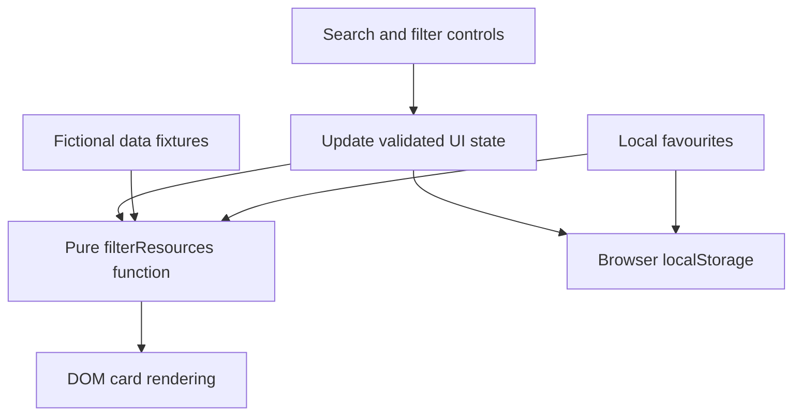

# Architecture and technical choices

This is an independent, static **portfolio example**, not extracted or copied from a live customer's Zendesk account.

## Data flow

## Why separate modules?

- `data.js` represents replaceable sample content.
- `filters.js` is pure and is covered by Node's native test runner.
- `main.js` manages browser state, rendering and event listeners without needing a framework.
- `styles.css` uses responsive grid breakpoints to preserve usability on narrow screens.

## Access and security boundary

All fixtures are public and fictional. The `moderator` boolean illustrates badge presentation only. It does **not** inspect real Zendesk comments or verify an agent's permissions. In a real platform, role-specific user metadata should be returned only from appropriately authorised services; hiding it with CSS or frontend templates is not sufficient protection.

## Possible future improvements

- Live Zendesk Guide integration through an authorised backend.
- URL-addressable filters, pagination and browser history.
- Automated browser-based accessibility checks.
- Moderator indicators from a verified, rate-limited comments service.

All of these are future ideas, not shipped capabilities of this demo.
